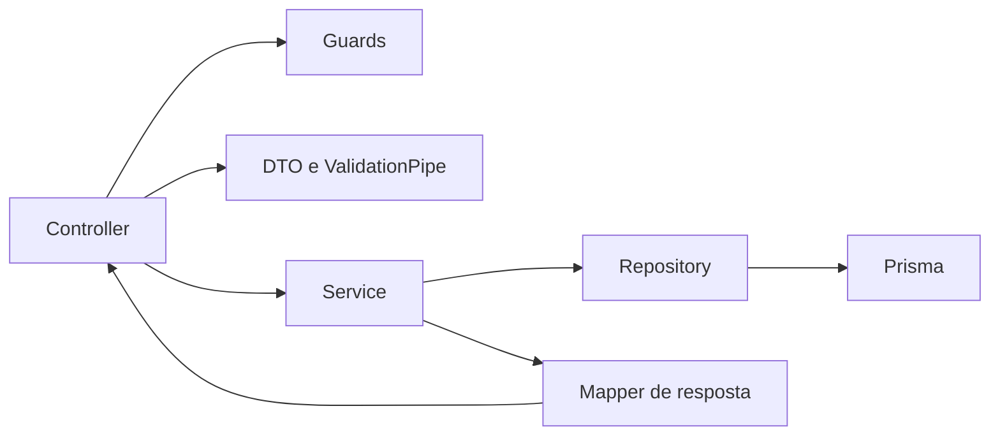

# Arquitetura da API

O backend usa NestJS por domínio, Prisma para persistência PostgreSQL e serviços de infraestrutura compartilhados para autenticação, e-mail e arquivos. Este guia documenta a divisão atual e o caminho recomendado para mudanças.

## Fluxo de uma requisição

O controller define rotas, parâmetros e autorização declarativa. DTOs descrevem e validam a entrada. Services aplicam regras de negócio e coordenam operações. Repositories concentram consultas e gravações Prisma. Mappers controlam o formato público das respostas.

## Organização

- `src/main.ts`: bootstrap, `ValidationPipe`, filtros globais e servidor HTTP.
- `src/app.module.ts`: composição dos módulos da aplicação.
- `src/modules/<domínio>`: controllers, services, repositories, DTOs, tipos, mappers e testes próximos da funcionalidade:
  - `auth`: cadastro, login, confirmação e recuperação de conta; guards e estratégia JWT ficam dentro do domínio.
  - `users`: operações administrativas e representação segura do usuário.
  - `profile`: leitura e atualização do perfil, avatar e visibilidade dos dados.
  - `products`: catálogo, guias, imagens, artigos relacionados e favoritos.
  - `articles`: conteúdo em blocos, leitura, comentários, reações e salvamentos.
  - `training`: perguntas, respostas idempotentes, progresso e ranking.
  - `preferences`: preferências do usuário.
  - `storage` e `mail`: integrações externas compartilhadas, não regras de tela.
  - `settings`: configuração tipada da aplicação.

### Módulo de artigos

`ArticlesController` e `SavedArticlesController` continuam usando `ArticlesService`, uma fachada de compatibilidade sem regras de negócio. Cada fluxo fica no serviço especializado correspondente:

- `ArticleQueriesService`: listagem, pesquisa, paginação e leitura pública/administrativa; usa os mappers existentes.
- `ArticleManagementService`: criação, edição e despublicação lógica.
- `ArticleSlugService`: geração de candidato de slug único; o gerenciamento traduz conflito `P2002` para a resposta já estabelecida.
- `ArticleCommentsService`: autoria, edição, exclusão lógica e moderação.
- `ArticleEngagementService`: reações e ciclo completo dos artigos salvos, inclusive listagem paginada.
- `ArticleBlocksService`: criação, atualização, ordenação e remoção dos blocos.
- `ArticleBlockImagesService`: upload, URL pré-assinada, validação e remoção de imagens dos blocos.
- `ArticleImagesService`: upload e associação da imagem principal do artigo.
- `ArticleAccessService`: visibilidade do artigo e associação do bloco ao artigo.

Regras determinísticas ficam em `utils`: publicação e datas, normalização editorial/tempo de leitura, erros do domínio e validação comum de arquivos. `ArticlesRepository` continua sendo o único acesso a dados. O `ArticlesModule` registra todos os colaboradores; controllers e contratos públicos permanecem inalterados.
## Como implementar uma mudança

1. Coloque contratos de entrada em DTOs e valide-os com os decorators existentes.
2. Mantenha autorização no guard/decorators da rota e restrições de propriedade no service/repository, conforme a regra específica.
3. Deixe controllers enxutos: adaptar HTTP para a chamada do service e retornar o resultado.
4. Mantenha regra de negócio em services; mova consultas Prisma para o repository do domínio quando forem usadas por mais de uma operação ou quando a consulta exigir composição significativa.
5. Use mappers para evitar exposição acidental de campos internos do Prisma.
6. Coloque utilitários em `common` somente quando houver mais de um consumidor real e uma semântica compartilhada clara.
7. Para mudança de banco, crie uma migration aditiva quando possível, valide em PostgreSQL descartável e nunca use seed para sobrescrever dados existentes.
8. Cubra regra de service com teste unitário e fronteiras HTTP/persistência com integração PostgreSQL quando aplicável.

## Regras de segurança e manutenção

- Não retorne modelos Prisma diretamente quando contiverem campos privados, credenciais, respostas corretas ou dados internos.
- Não registre tokens, connection strings, códigos de confirmação ou dados pessoais em logs.
- Mantenha transações e condições de idempotência junto à operação de negócio que precisa delas.
- Evite dependências entre domínios que formem ciclos; compartilhe contratos ou operações pequenas por módulos explícitos.
- Não crie abstrações genéricas para uma única regra. Centralize apenas comportamento repetido cuja semântica seja igual.
- Toda alteração de runtime deve preservar os testes e a validação PostgreSQL definidos em `.github/workflows/ci.yml`.

## Validação local

`npm run lint`, `npx tsc --noEmit`, `npm run build`, `npx prisma validate` e `npm test -- --runInBand` são os comandos principais. Execute a suíte de integração contra banco descartável e nunca contra homologação ou produção. Preparação de deploy está em [deployment-readiness.md](deployment-readiness.md).

### Módulo de produtos

`ProductsService` é uma fachada de compatibilidade para os controllers. As operações do domínio ficam distribuídas conforme o fluxo:

- `ProductQueriesService`: catálogo, busca, paginação e detalhe; usa o mapper público existente.
- `ProductManagementService` e `ProductSlugService`: cadastro, edição, desativação lógica, normalização do conteúdo e geração de slug exclusivo.
- `ProductFavoritesService`: inclusão, remoção idempotente e listagem paginada de favoritos.
- `ProductArticleRelationsService`: criação, atualização da ordenação e remoção de vínculos entre produtos e artigos.
- `ProductImagesService`: imagem principal do cadastro.
- `ProductGalleryService`: metadados, uploads, substituição, imagem primária e exclusão das imagens adicionais. A compensação do registro criado permanece no fluxo de upload que pode falhar.
- `ProductGuideSectionsService`: criação, edição, exclusão e imagem das seções educativas.
- `ProductAccessService`: verifica produto ativo e associação de artigos, imagens e seções aos respectivos pais.
- `ProductsRepository` permanece como fronteira única de acesso Prisma.

A validação de arquivos é compartilhada em `storage/image-upload.validation.ts`, mantendo regras e mensagens de MIME e tamanho iguais para artigos e produtos. Normalização e erros específicos de produto ficam em funções pequenas do domínio; operações com dependências permanecem em serviços NestJS.
### Uploads gerenciados no R2

Uploads multipart geram uma chave interna junto da URL, mas a chave não faz parte das respostas HTTP. A compensação após erro de persistência consulta os campos de URL de usuários, produtos, imagens da galeria, guias, artigos, capas e blocos. Só tenta excluir a chave específica do upload se nenhuma entidade a referenciar. A chave também precisa corresponder ao prefixo da entidade e ao nome de arquivo gerado pelo backend. Falhas na leitura do estado ou na exclusão preservam o objeto e são registradas sem URL, chave ou credenciais. Imagens anteriores nunca são removidas por substituição.

Uploads pré-assinados de blocos são diferentes: o cliente envia diretamente ao R2 e o backend não observa se o PUT terminou. `ArticleBlockUploadTrackingService` grava uma intenção antes de devolver a URL assinada; a URL assinada nunca é persistida. A resposta HTTP continua contendo `key`, `uploadUrl` e `url`. Ao associar uma URL rastreada, o serviço confirma escopo artigo/bloco e consulta `HeadObject` para verificar existência, MIME e tamanho. A gravação do bloco e a transição `PENDING` → `ASSOCIATED` ocorrem na mesma transação PostgreSQL. URLs gerenciadas anteriores sem intenção continuam aceitas pelo caminho legado.

`PresignedUploadReconciliationService` executa somente diagnóstico explícito, paginado e iniciado pelos registros da tabela `PresignedUploadIntent`; não varre o bucket e nunca apaga objetos. Tentativas `PENDING` são consideradas expiradas apenas depois da validade da URL mais o período de segurança. Um objeto existente de uma tentativa ainda `PENDING`, sem URL encontrada em qualquer campo de imagem gerenciado, é classificado como potencialmente órfão, não como prova para exclusão. O estado do ciclo de vida é relido após as consultas lentas ao R2; tentativas `ASSOCIATED` sem referência atual são indeterminadas, nunca classificadas como abandonadas. A leitura das referências ocorre depois das consultas `HeadObject` para reduzir a janela de concorrência. Falha de `HeadObject` ou de consulta de referências é indeterminada. ETag diferente ou indisponível também exige investigação. O comando `npm run uploads:reconcile-presigned -- --confirm-target=host/database` exige `PRESIGNED_UPLOAD_RECONCILIATION_DATABASE_URL` explícita, recusa `NODE_ENV=production` e só imprime um relatório. A URL de conexão e a URL assinada não são impressas.

PostgreSQL e R2 não compartilham transação distribuída. Uma falha após um PUT pode deixar objeto não associado; uma atualização de status falha depois de um PUT pode deixar tentativa pendente. A reconciliação fornece evidência para revisão manual, não uma autorização de limpeza. Nenhuma tentativa, referência ou objeto é excluído automaticamente. Uploads multipart continuam usando a compensação da Etapa 6.3.
