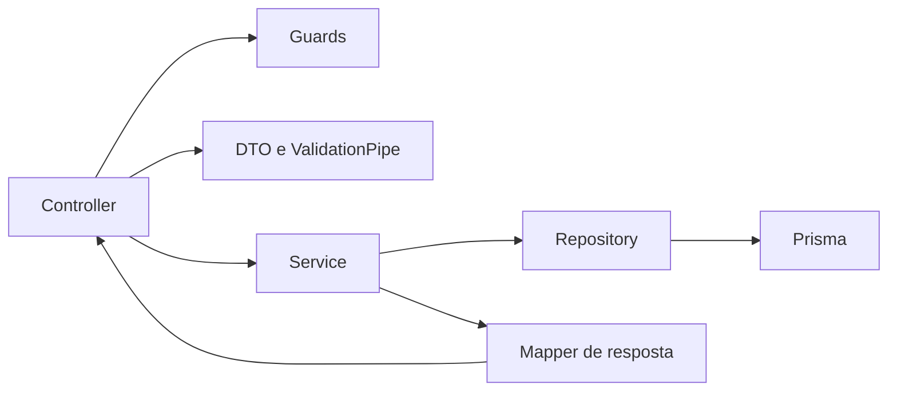

# Arquitetura da API

O backend usa NestJS por domínio, Prisma para persistência PostgreSQL e serviços de infraestrutura compartilhados para autenticação, e-mail e arquivos. Este guia documenta a divisão atual e o caminho recomendado para mudanças.

## Fluxo de uma requisição

O controller define rotas, parâmetros e autorização declarativa. DTOs descrevem e validam a entrada. Services aplicam regras de negócio e coordenam operações. Repositories concentram consultas e gravações Prisma. Mappers controlam o formato público das respostas.

## Organização

- `src/main.ts`: bootstrap, `ValidationPipe`, filtros globais e servidor HTTP.
- `src/app.module.ts`: composição dos módulos da aplicação.
- `src/modules/<domínio>`: controllers, services, repositories, DTOs, tipos, mappers e testes próximos da funcionalidade:
  - `auth`: cadastro, login, confirmação e recuperação de conta; guards e estratégia JWT ficam dentro do domínio.
  - `users`: operações administrativas e representação segura do usuário.
  - `profile`: leitura e atualização do perfil, avatar e visibilidade dos dados.
  - `products`: catálogo, guias, imagens, artigos relacionados e favoritos.
  - `articles`: conteúdo em blocos, leitura, comentários, reações e salvamentos.
  - `training`: perguntas, respostas idempotentes, progresso e ranking.
  - `preferences`: preferências do usuário.
  - `storage` e `mail`: integrações externas compartilhadas, não regras de tela.
  - `settings`: configuração tipada da aplicação.

### Módulo de artigos

`ArticlesController` e `SavedArticlesController` continuam usando `ArticlesService`, uma fachada de compatibilidade sem regras de negócio. Cada fluxo fica no serviço especializado correspondente:

- `ArticleQueriesService`: listagem, pesquisa, paginação e leitura pública/administrativa; usa os mappers existentes.
- `ArticleManagementService`: criação, edição e despublicação lógica.
- `ArticleSlugService`: geração de candidato de slug único; o gerenciamento traduz conflito `P2002` para a resposta já estabelecida.
- `ArticleCommentsService`: autoria, edição, exclusão lógica e moderação.
- `ArticleEngagementService`: reações e ciclo completo dos artigos salvos, inclusive listagem paginada.
- `ArticleBlocksService`: criação, atualização, ordenação e remoção dos blocos.
- `ArticleBlockImagesService`: upload, URL pré-assinada, validação e remoção de imagens dos blocos.
- `ArticleImagesService`: upload e associação da imagem principal do artigo.
- `ArticleAccessService`: visibilidade do artigo e associação do bloco ao artigo.

Regras determinísticas ficam em `utils`: publicação e datas, normalização editorial/tempo de leitura, erros do domínio e validação comum de arquivos. `ArticlesRepository` continua sendo o único acesso a dados. O `ArticlesModule` registra todos os colaboradores; controllers e contratos públicos permanecem inalterados.
## Como implementar uma mudança

1. Coloque contratos de entrada em DTOs e valide-os com os decorators existentes.
2. Mantenha autorização no guard/decorators da rota e restrições de propriedade no service/repository, conforme a regra específica.
3. Deixe controllers enxutos: adaptar HTTP para a chamada do service e retornar o resultado.
4. Mantenha regra de negócio em services; mova consultas Prisma para o repository do domínio quando forem usadas por mais de uma operação ou quando a consulta exigir composição significativa.
5. Use mappers para evitar exposição acidental de campos internos do Prisma.
6. Coloque utilitários em `common` somente quando houver mais de um consumidor real e uma semântica compartilhada clara.
7. Para mudança de banco, crie uma migration aditiva quando possível, valide em PostgreSQL descartável e nunca use seed para sobrescrever dados existentes.
8. Cubra regra de service com teste unitário e fronteiras HTTP/persistência com integração PostgreSQL quando aplicável.

## Regras de segurança e manutenção

- Não retorne modelos Prisma diretamente quando contiverem campos privados, credenciais, respostas corretas ou dados internos.
- Não registre tokens, connection strings, códigos de confirmação ou dados pessoais em logs.
- Mantenha transações e condições de idempotência junto à operação de negócio que precisa delas.
- Evite dependências entre domínios que formem ciclos; compartilhe contratos ou operações pequenas por módulos explícitos.
- Não crie abstrações genéricas para uma única regra. Centralize apenas comportamento repetido cuja semântica seja igual.
- Toda alteração de runtime deve preservar os testes e a validação PostgreSQL definidos em `.github/workflows/ci.yml`.

## Validação local

`npm run lint`, `npx tsc --noEmit`, `npm run build`, `npx prisma validate` e `npm test -- --runInBand` são os comandos principais. Execute a suíte de integração contra banco descartável e nunca contra homologação ou produção. Preparação de deploy está em [deployment-readiness.md](deployment-readiness.md).
